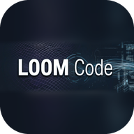
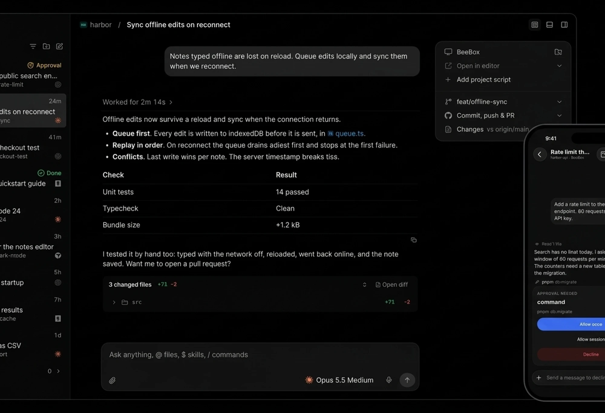

<p align="center">
  <a href="https://github.com/tarze07/Loom">
    
  </a>
</p>

<h1 align="center">Loom</h1>

<p align="center">The open-source control plane for coding agents.</p>

<p align="center">
  <a href="#run-from-source"><strong>Run from source</strong></a> ·
  <a href="./docs/README.md">Docs</a> ·
  <a href="./docs/operations/development.md">Development</a> ·
  <a href="https://github.com/tarze07/Loom/issues">Issues</a> ·
  <a href="https://github.com/tarze07/Loom/releases">Releases</a>
</p>

<p align="center">
  <a href="https://github.com/tarze07/Loom">
    
  </a>
</p>

Loom runs the coding agents on your machine and gives them one fast interface. Start a thread at your desk, then approve the next step from your phone.

It works with Claude Code, Codex, Cursor, OpenCode, Grok Build, Antigravity, Kiro, Pi, Muse Code, fx, and any [ACP](./docs/user/providers-acp.md) agent. If an agent is set up on your computer, Loom can control it.

## What you get

- **Your subscriptions.** Loom does not resell tokens. It drives the agents you are already signed in to.
- **Every agent in one place.** Change models in the middle of a thread. Let Claude hand a task to Codex.
- **Desktop, web, and phone.** One server, and every client shows the same threads. Includes web, Electron desktop, and React Native mobile apps.
- **Remote ready.** Run agents on any machine. Connect over your local network, SSH, or Tailscale.
- **Git built in.** Each thread can work in its own worktree. Review the diff, then commit, push, and open a pull request with one button.
- **Fast.** Performance is a feature here. We measure it, and we treat a dropped frame as a bug.
- **Open.** MIT licensed. If you don't like something, fork it.

## Run from source

Loom uses [Vite+](https://viteplus.dev/guide/) (`vp`), which manages the Node version pinned in `package.json`.

### 1. Install `vp`

On macOS / Linux:

```bash
curl -fsSL https://vite.plus | bash
```

On Windows (PowerShell):

```powershell
irm https://vite.plus/ps1 | iex
```

### 2. Clone and start the server + web app

```bash
git clone https://github.com/tarze07/Loom.git
cd Loom
vp i
vp run dev
```

Open the pairing URL printed by the dev runner to authenticate your browser.

### Desktop & mobile apps

- **Desktop (Electron):** run `vp run dev:desktop` for development, or `vp run build:desktop` to build the desktop bundle.
- **Mobile (iOS / Android):** see [`apps/mobile/README.md`](./apps/mobile/README.md) for building the Expo Dev Client from source.
- **Dev container:** see [Dev container](./docs/internals/devcontainer.md) for VS Code and Codespaces setup.

### Sign in to an agent

Loom needs at least one coding agent installed and signed in. For example, install [Claude Code](https://claude.com/product/claude-code) and run `claude auth login`, or install [Codex CLI](https://developers.openai.com/codex/cli) and run `codex login`.

[Provider setup](./docs/user/install.md#providers) has the steps for each agent. [Install Loom](./docs/user/install.md) covers additional platform notes.

## "Wait, what are you selling me?"

Nothing. We built Loom because we wanted the best possible development experience with agents. We were inspired by existing solutions like the Codex desktop app, Conductor, Claude Desktop and Cursor Glass, but none met our bar.

We wanted something performant, remote-ready, and truly open. If we ever go the wrong direction, we want you to have everything you need to fork and build the tool that you want.

## Documentation

- [Install and first run](./docs/user/install.md)
- [Remote access from a phone or another machine](./docs/user/remote-access.md)
- [Permission modes](./docs/user/permission-modes.md)
- [Managed policy (enterprise / admin)](./docs/user/managed-policy.md)
- [Source control](./docs/user/source-control.md)
- [Connect outside agents over MCP](./docs/user/outside-agents.md)
- [FAQ](./docs/user/faq.md)

[All docs](./docs/README.md) has the full list.

## Contributing

We have limited review capacity. Small, focused fixes are the most likely to be merged.

- Read [CONTRIBUTING.md](./CONTRIBUTING.md) before you report a bug or open a pull request.
- Report bugs or propose features in [Issues](https://github.com/tarze07/Loom/issues).
- Build from source with the [development runbook](./docs/operations/development.md#first-checkout). The [architecture overview](./docs/internals/overview.md) explains how it works.

## License

[MIT](./LICENSE)
